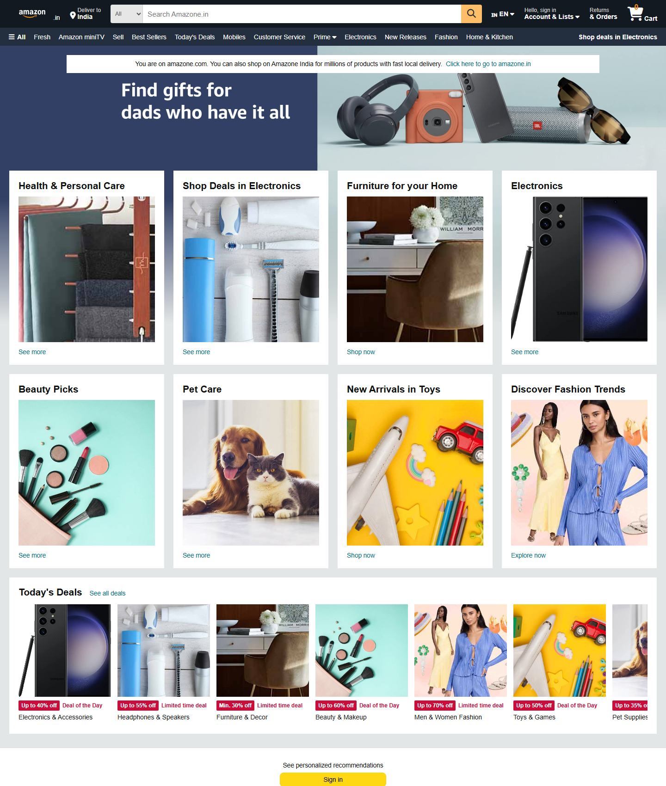
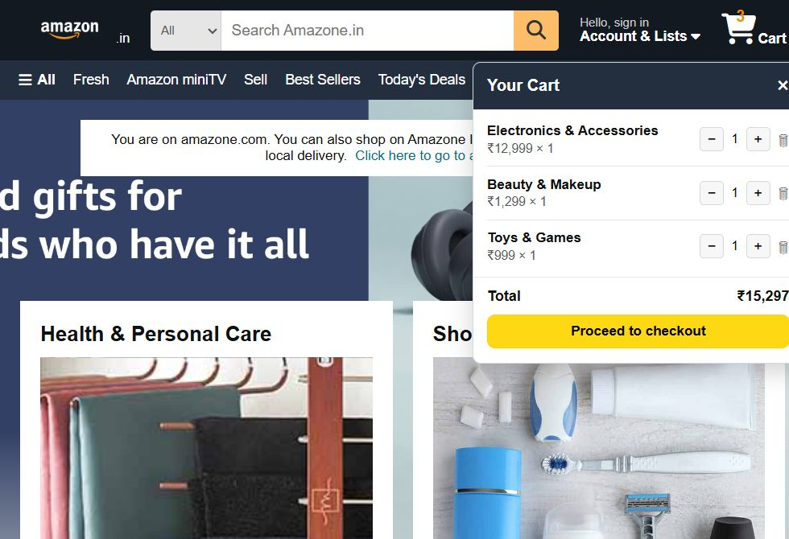
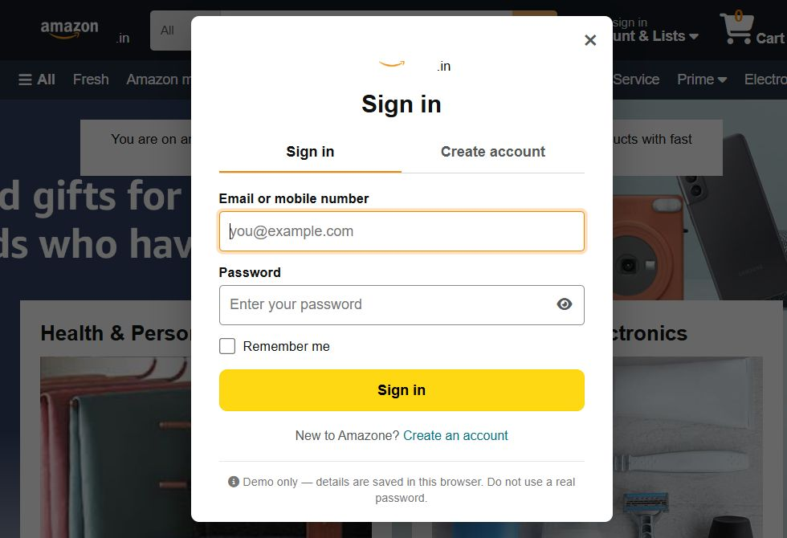
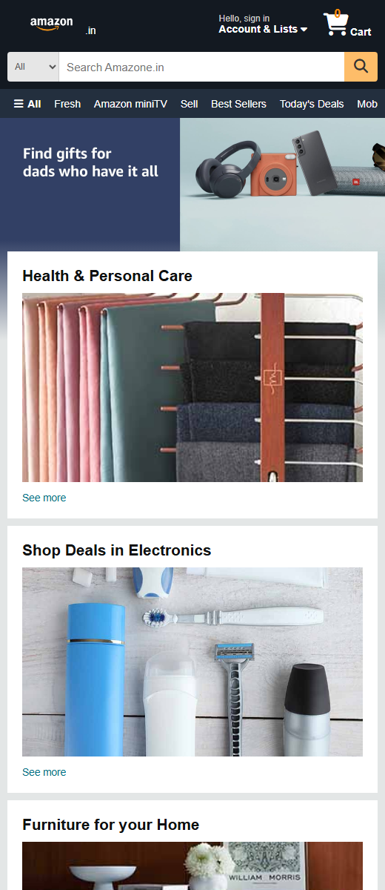

# 🛒 Amazone Clone

A responsive clone of the **Amazon India homepage**, built with plain **HTML5**, **CSS3** and a little **vanilla JavaScript**: no frameworks, no dependencies and no build step.

🔗 **Live demo:** https://asifghaus350.github.io/Amazone_clone/



---

## ✨ Features

At a glance:

| Area | Highlights |
|---|---|
| Header | Dark navbar, search + category dropdown, cart badge, account menu |
| Browse | Hero banner, 8 category cards, Today's Deals carousel |
| Search | Live text filter + category filter with "no results" hints |
| Cart | Add to cart, live count, mini cart, quantity controls, saved locally |
| Account | Sign up, sign in, remember me, profile dropdown, sign out |
| Design | Responsive from 4-column desktop to 1-column mobile |
| Extras | Smooth scrolling, hover states, password show/hide, accessible dialogs |

### Header
- Amazon-style dark navbar (`#131921`) with logo and **“Deliver to India”** location
- **Search bar** with category dropdown and orange search button, plus an orange glow on focus
- Language selector, **Account & Lists**, **Returns & Orders**
- **Cart** icon with item count badge
- White hover outline on every nav item, as on the real site

### Sub-navigation
- **☰ All** menu plus quick links: Fresh, miniTV, Sell, Best Sellers, Today's Deals, Mobiles, Prime, Electronics, Fashion, Home & Kitchen…
- “Shop deals in Electronics” highlight on the right

### Homepage body
- **Hero banner** that fades into the page background
- **8 category cards** overlapping the hero:
  Health & Personal Care · Electronics Deals · Furniture · Electronics · Beauty · Pet Care · Toys · Fashion
- **Today's Deals** horizontal scroll row with red discount badges (`Up to 40% off`, `Deal of the Day`, …)
- **Sign-in prompt** with the yellow Amazon button

### Interactive features (JavaScript)
- **Live search** — type in the search box to instantly filter category cards and deals
- **Category dropdown** — narrow results to Electronics, Fashion, Beauty, etc.
- **"No results" hints** shown when nothing matches
- **Add to cart** button on every deal with a live cart count in the navbar
- **Mini cart panel** — review items, change quantities, remove items and see the total
- Cart contents are saved in **localStorage**, so they survive a page refresh

### Sign in / Create account (JavaScript demo)
- **Account & Lists** opens a sign-in modal; after signing in it shows an account dropdown
- **Create account** form with name, email, password and confirm-password validation
- **Sign in** form with error messages and a **Remember me** option (localStorage vs sessionStorage)
- Password show/hide toggle, Escape / backdrop to close
- Sign-out available from the dropdown and the homepage prompt
- ⚠️ Demo only: accounts are saved as plain text in this browser — do **not** use a real password

### Footer
- **Back to top** link with smooth scrolling
- 4 link columns: *Get to Know Us*, *Connect with Us*, *Make Money with Us*, *Let Us Help You*
- Language and country buttons, legal links, copyright

### Responsive design
| Screen width | Category grid | Notes |
|---|---|---|
| > 1100px | 4 columns | Full navbar |
| 800–1100px | 3 columns | Language and Returns hidden |
| 560–800px | 2 columns | Address and deals link hidden |
| < 560px | 1 column | Search moves to its own row |

---

## 📸 Screenshots

| Desktop homepage | Cart panel |
|---|---|
|  |  |

| Sign-in modal | Mobile layout |
|---|---|
|  |  |

---

## 🧰 Tech Stack

| Technology | Use |
|---|---|
| HTML5 | Semantic page structure (`header`, `nav`, `main`, `section`, `footer`) |
| CSS3 | Flexbox, CSS Grid, gradients, media queries |
| [Font Awesome 6](https://fontawesome.com/) | Icons (location, search, cart, menu) |
| JavaScript (vanilla) | `script.js` | Search filter, add to cart, live cart count and persistence |

---

## 📁 Project Structure

```
Amazone_clone/
├── index.html          # Page markup
├── style.css           # All styles + responsive breakpoints
├── script.js           # Search filter, cart and sign-in logic
├── amazon_logo.png     # Logo
├── hero_image.jpg      # Hero banner
├── box1_image.jpg … box8_image.jpg   # Category card images
└── screenshots/        # README previews
    ├── desktop.png         # Desktop homepage
    ├── mobile.png          # Mobile layout
    ├── cart-panel.jpg      # Mini cart
    └── signin-modal.jpg    # Sign-in modal
```

---

## 🚀 Getting Started

No installation is needed.

```bash
# 1. Clone the repo
git clone https://github.com/asifghaus350/Amazone_clone.git

# 2. Open the folder
cd Amazone_clone

# 3. Open index.html in your browser
start index.html      # Windows
open index.html       # macOS
xdg-open index.html   # Linux
```

**Recommended:** open the folder in VS Code and use the **Live Server** extension (*right-click `index.html` → Open with Live Server*) so the page reloads automatically while you edit.

---

## 🧪 How to Use

There are no pre-created accounts or products — everything runs locally in your browser.

### 🔍 Search
1. Type a word such as `beauty`, `electronics` or `toys` in the search box.
2. Category cards and deals filter **as you type**.
3. Use the dropdown next to the search box to filter by category only.
4. Press **Enter** or click the orange search button to jump to the results.

### 🛒 Cart
1. Click **Add to cart** on any deal in the *Today's Deals* row — the badge in the navbar increases.
2. Click the **Cart** icon to open the mini cart.
3. Use **+ / −** to change quantities, the bin icon to remove an item, and see the total update.
4. The cart is saved in `localStorage`, so it is still there after a refresh.

### 👤 Sign up / Sign in
1. Click **Account & Lists** (or **Sign in**) — the sign-in modal opens.
2. Choose **Create account**, enter a name, email, password (6+ characters) and confirm it.
3. You are signed in automatically: the navbar shows *Hello, Asif* (or your first name) and the homepage shows a welcome message.
4. Sign out from the **account dropdown** or the homepage button.

**Demo data you can use to try it:**

| Field | Value |
|---|---|
| Name | `Demo User` |
| Email | `demo@example.com` |
| Password | `demo123` |

> ⚠️ There is no shared database — accounts are stored **only in your own browser**. Use a throwaway password, never a real one.

---

## 🌿 Git Workflow (branch & pull request)

Development happens on a feature branch; `main` stays clean and is updated through a Pull Request.

```bash
# 1. Make sure you are on main and it is up to date
git checkout main
git pull origin main

# 2. Create and switch to a feature branch
git checkout -b user/asif/nov

# 3. Work, then stage and commit
git add .
git commit -m "Describe your change"

# 4. Push the branch to GitHub
git push -u origin user/asif/nov
```

Then on GitHub: open the repo → **Compare & pull request** → base `main` ← compare `user/asif/nov` → create the PR → merge after review.

---

## 🎨 Color Palette

| Color | Hex | Used for |
|---|---|---|
|  Navbar | `#131921` | Top header |
|  Sub-nav | `#232f3e` | Sub navbar, footer |
|  Back to top | `#37475a` | Footer top strip |
|  Search orange | `#febd69` | Search button, focus ring |
|  Button yellow | `#ffd814` | Sign-in button |
|  Link teal | `#007185` | “See more” links |
|  Deal red | `#cc0c39` | Discount badges |
|  Background | `#e3e6e6` | Page background |

---

## 🗺️ Roadmap

- [x] Responsive homepage UI
- [x] JavaScript: working search filter
- [x] JavaScript: add to cart with live cart count
- [x] Mini cart panel with quantity controls (localStorage)
- [x] Sign in / create account (localStorage demo)
- [ ] Auto-sliding hero carousel
- [ ] Product detail and cart pages
- [ ] Backend (Node.js / Express) with product database and login

---

## 👤 Author

**Asif Ghaus**: [@asifghaus350](https://github.com/asifghaus350)

If you found this useful, consider giving the repo a ⭐!

---

## ⚠️ Disclaimer

This is a **personal learning project** made to practise HTML and CSS. It is **not affiliated with, endorsed by, or connected to Amazon.com, Inc.** “Amazon” and its logo are trademarks of Amazon.com, Inc. or its affiliates. No real products are sold and no user data is collected.
